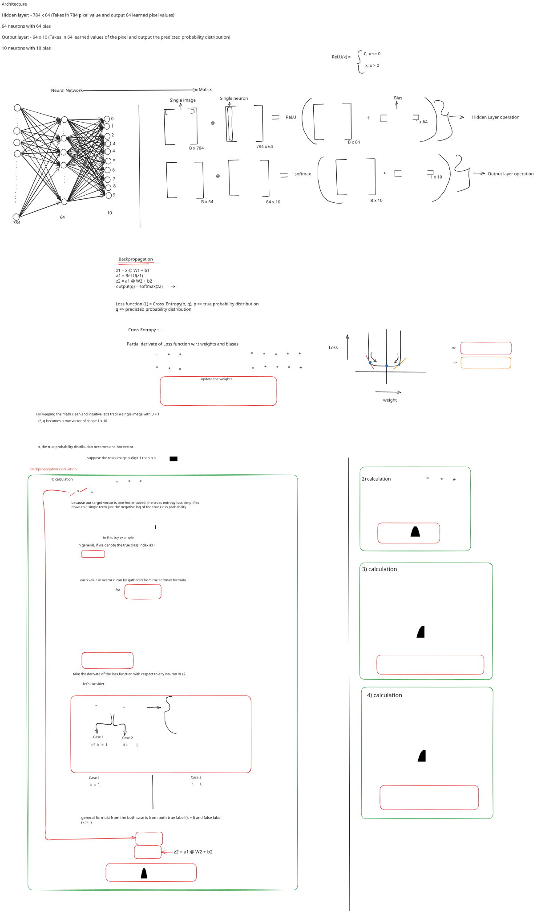

# MNIST: NumPy vs PyTorch

A handwritten-digit classification project comparing a neural network
implemented from scratch with **NumPy** against an equivalent
neural-network architecture built with **PyTorch**.

The project focuses on understanding the mechanics behind neural-network
training: data preprocessing, forward propagation, ReLU activation,
Softmax, cross-entropy loss, backpropagation, parameter updates,
inference, and evaluation.

## Project overview

This project contains two implementations of an MNIST classifier:

1.  **NumPy implementation** --- manually reads the compressed MNIST IDX
    files, performs preprocessing, implements the forward pass and
    backpropagation, and updates the model parameters using gradient
    descent.
2.  **PyTorch implementation** --- builds the same layer dimensions
    using `torch.nn`, trains with `CrossEntropyLoss` and Adam, and saves
    the trained model weights as a `.pth` file.

Both implementations use a fully connected network with the same layer
dimensions:

``` text
Input image (28 × 28)
        │
      Flatten
        │
     784 features
        │
   Linear: 784 → 64
        │
       ReLU
        │
   Linear: 64 → 10
        │
  10 class scores
        │
  Predicted digit (0–9)
```

## Dataset and preprocessing

The project uses the **MNIST handwritten digit dataset**:

-   Training set: 60,000 images
-   Test set: 10,000 images
-   Image dimensions: 28 × 28 pixels
-   Number of classes: 10 (digits 0--9)

### NumPy pipeline

The NumPy implementation reads the compressed IDX image and label files
directly using Python's `gzip` module and NumPy's `frombuffer`.

The image data is: 1. Rescaled by dividing pixel values by the maximum
pixel value. 2. Normalized using the mean and standard deviation
calculated from the training images. 3. Flattened from 28 × 28 into 784
features when passed to the network.

The training-set statistics reported by the notebook are:

  Statistic                  Value
  -------------------- -----------
  Mean                   0.1306605
  Standard deviation     0.3081078

The same training-set mean and standard deviation are used to normalize
the test images.

### PyTorch pipeline

The PyTorch implementation loads MNIST through
`torchvision.datasets.MNIST` and applies:

-   `transforms.ToTensor()`
-   `transforms.Normalize((0.1307), (0.3081))`

The training DataLoader uses a batch size of 64 and shuffles the
training data. The test DataLoader loads the test set in one batch.

## NumPy implementation

The NumPy model uses the following operations:

-   **Forward propagation:** matrix multiplication and bias addition for
    each linear layer.
-   **ReLU:** applies the hidden-layer activation.
-   **Softmax:** converts the output logits into class probabilities,
    with the maximum logit subtracted before exponentiation for
    numerical stability.
-   **Cross-entropy:** computes the loss against one-hot encoded labels.
-   **Backpropagation:** calculates gradients for both weight matrices
    and bias vectors.
-   **Parameter update:** applies gradient descent with a learning rate
    of `0.01`.

The model is trained for **5 epochs**, using mini-batches of 64 samples.

### Backpropagation derivation

The accompanying diagram documents the network's forward pass and the
gradient calculations used to update the parameters.



## PyTorch implementation

The PyTorch model uses the same layer dimensions:

-   `nn.Linear(784, 64)`
-   `nn.ReLU()`
-   `nn.Linear(64, 10)`

Training configuration:

  | Setting         | Value |
  | :--- | :---: |
  | Loss function   | `nn.CrossEntropyLoss()` |
  | Optimizer       | Adam |
  | Learning rate   | 0.001 |
  | Batch size      | 64 |
  | Epochs          | 5 |
  | Device          | CUDA when available; otherwise CPU |

PyTorch handles automatic differentiation through `loss.backward()` and
updates the parameters through the optimizer.

The trained model's state dictionary is saved as `MNIST_model.pth`. The
evaluation example recreates the model architecture and loads the saved
state dictionary.

## Evaluation results

The following are the test-set metrics printed by the supplied notebook
after training.

| Metric | NumPy | PyTorch |
| :--- | :---: | :---: |
| Accuracy | 92.9751% | 97.4615% |
| Macro recall | 92.9751% | 97.4615% |
| Macro precision | 92.9798% | 97.4750% |
| Macro F1-score | 92.9626% | 97.4629% |

Metrics are calculated with **TorchMetrics** using the multiclass task
and 10 classes. The NumPy model's probability predictions are converted
to a PyTorch tensor for metric calculation; the PyTorch model's output
scores (logits) are passed to TorchMetrics.

### Important comparison note

The two implementations share the same network layer dimensions, but
they do **not** use identical training configurations:

-   NumPy uses manually implemented gradient descent with a learning
    rate of `0.01`.
-   PyTorch uses Adam with a learning rate of `0.001`.
-   Their parameter initialization procedures also differ.

Therefore, these results compare the outcomes of the two implementations
as configured in this project. They should not be interpreted as a
controlled comparison of NumPy and PyTorch performance under identical
optimization conditions.

## Technologies used

-   Python
-   NumPy
-   PyTorch
-   Torchvision
-   TorchMetrics
-   Matplotlib
-   gzip (Python standard library)

## Repository contents

-   NumPy implementation of MNIST data loading, preprocessing, model
    training, prediction, and evaluation.
-   PyTorch implementation of the MNIST model, training, inference, and
    saving/loading model weights.
-   Backpropagation derivation diagram (SVG).

## What this project demonstrates

-   Preparing and normalizing image data.
-   Understanding the dimensions and flow of matrix operations in a
    neural network.
-   Implementing ReLU and Softmax.
-   Deriving and applying gradients through backpropagation.
-   Training a neural network with manually updated parameters.
-   Building and training the corresponding architecture with PyTorch.
-   Saving and loading a PyTorch `state_dict`.
-   Evaluating multiclass classification with accuracy, precision,
    recall, and F1-score.
